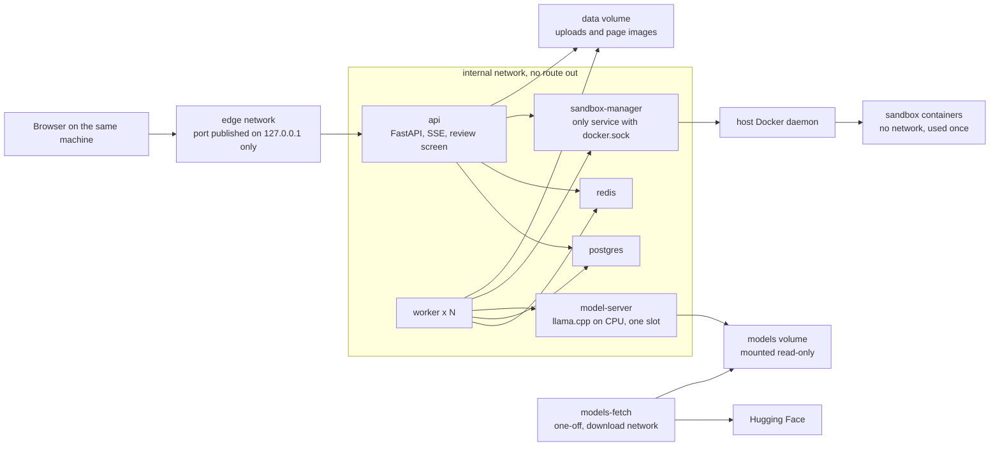
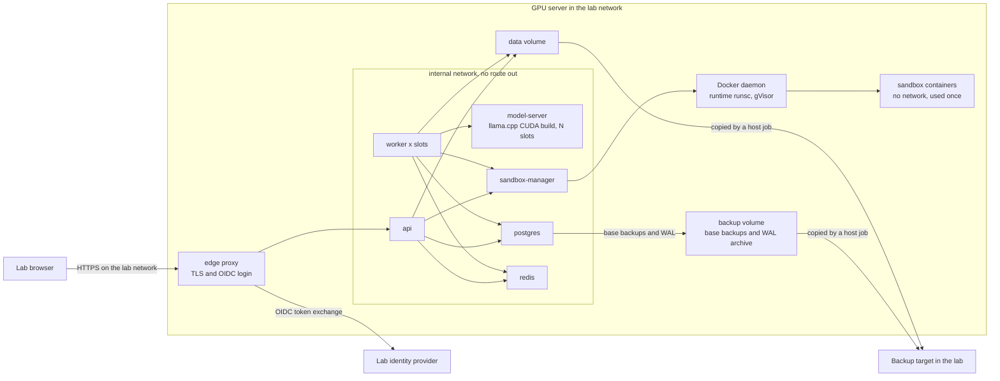
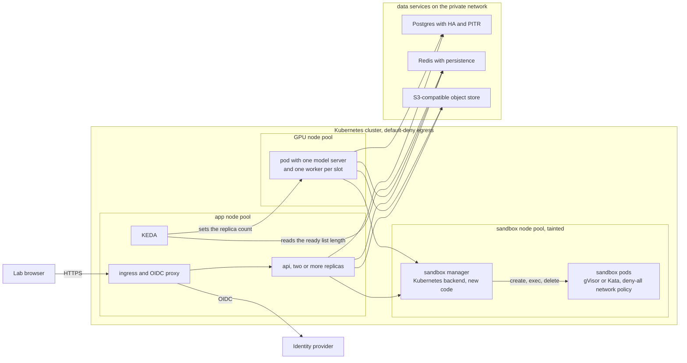
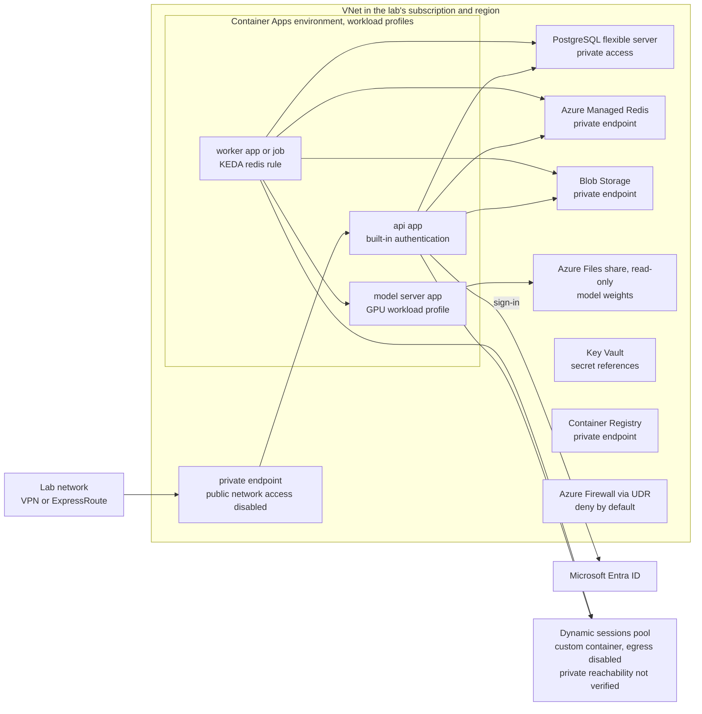
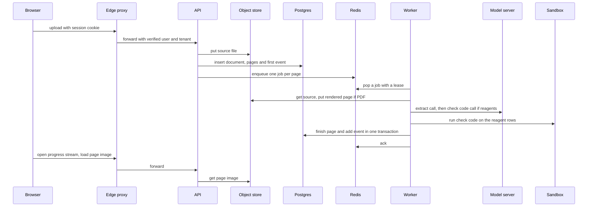
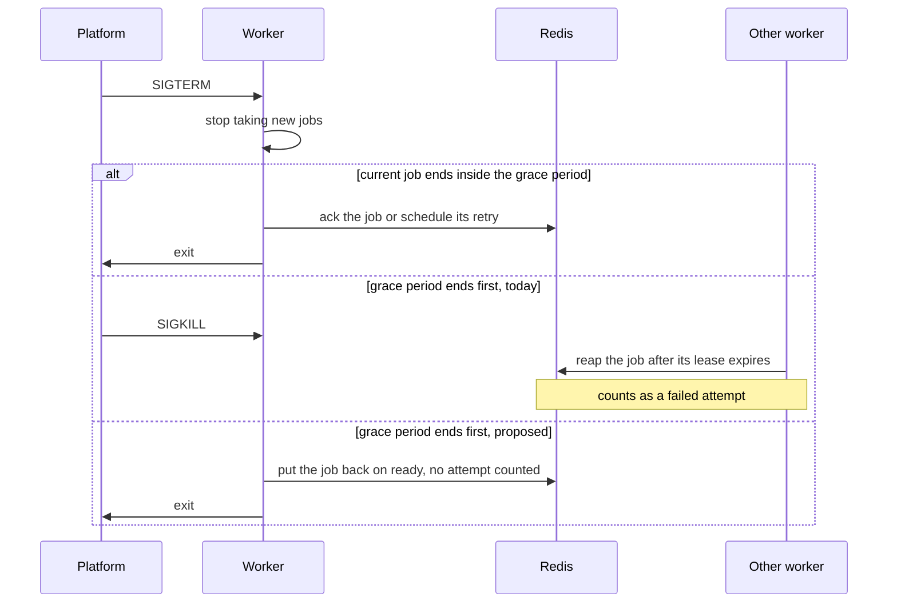
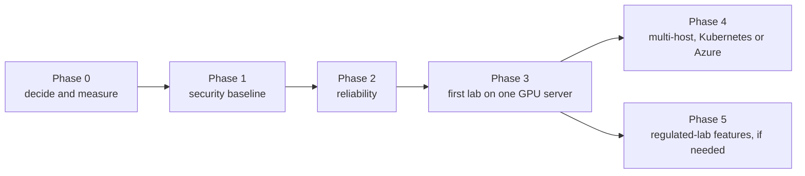

# Running it in production

This is a design proposal for the team that would deploy Lab Notebook Digitizer for real labs.
What exists today is one Docker Compose stack on one machine (see the [README](../README.md)).
Every section keeps two things apart:

- **Today:** what the code and compose files do now, with the file that does it.
- **Proposed:** design only. Not built, and not tested anywhere.

Why today's choices were made is in [DESIGN.md](../DESIGN.md). How the system works end to end
is in [architecture.md](architecture.md). This document links to them instead of repeating them.

## The four promises

Every proposal below must keep these:

1. Notebook data stays on infrastructure the lab controls.
2. The model runs locally, inside that infrastructure. No call goes to an outside model API.
3. Containers that handle notebook data have no route to the internet.
4. Code written by the model runs only inside a sandbox.

## Machines behind the numbers

| Name | Machine | Used for |
|---|---|---|
| Mac | Apple M5 MacBook Air (Mac17,3; 10 cores = 4 performance + 6 efficiency; 32 GB; fanless), macOS 26.6.2. Docker Desktop 29.8.2 runs a Linux VM with 8 vCPUs and 14.7 GB RAM. Containers have no GPU. llama.cpp b11718 on CPU. | Timings with the real model |
| VM | The 2 vCPU / 8 GB cloud VM described in the [README results](../README.md#results). No GPU. | Load test with a fake model, sandbox start times |

Nothing in this document was measured on a GPU. Extraction accuracy with the real model was
measured on the Mac: 100% of 400 fields on 20 synthetic pages (README, Results). Real notebooks
will score lower; there is no answer key for real pages yet.

## Contents

1. [Goals and constraints](#1-goals-and-constraints)
2. [Deployment options](#2-deployment-options)
3. [Model serving](#3-model-serving)
4. [Storage](#4-storage)
5. [Identity, tenancy and security](#5-identity-tenancy-and-security)
6. [Audit trail and data lifecycle](#6-audit-trail-and-data-lifecycle)
7. [Observability](#7-observability)
8. [Reliability](#8-reliability)
9. [Scaling and capacity](#9-scaling-and-capacity)
10. [Rollout plan](#10-rollout-plan)
11. [Sources](#11-sources)

## 1. Goals and constraints

### 1.1 Production goals

| Goal | Today | Proposed |
|---|---|---|
| Data residency | One machine. Data lives in the Docker volumes `pgdata`, `redisdata`, `data` and `models`. | Every store sits in the lab's data center, or in a cloud subscription and region the lab controls. That includes backups, logs, metrics and traces. No third-party service in the data path unless the lab approves it. |
| No egress for data containers | The `internal` network has no route out, `edge` has IP masquerading off (which blocks the internet on a Linux host but not on Docker Desktop for Mac, as measured), and sandboxes run with `network_mode: none`. `tests/test_compose.py` and `tests/test_egress.py` check the networks, and `tests/test_sandbox_escape.py` checks the sandbox's `network_mode: none` ([DESIGN.md §6](../DESIGN.md#6-network-lockdown)). | The platform enforces the same rule: default-deny egress on Kubernetes, a deny-by-default firewall on Azure, a host firewall on-prem. The egress test is ported so it runs in each environment after each deploy. |
| Audit trail of edits | Each edit is a new row in `page_versions` with `editor`, `note` and `created_at`. The editor is a free-text name sent by the client. | Editor taken from a verified login, append-only enforced by the database, tamper-evident export. See [section 6](#6-audit-trail-and-data-lifecycle). |
| Multi-tenant isolation | The `X-Tenant` header names the tenant. It is not authentication ([DESIGN.md §8](../DESIGN.md#8-choices-that-are-simple-on-purpose)). Some endpoints are not tenant-scoped. | Tenant taken from a verified token. One deployment per lab, or row-level security in a shared deployment. See [section 5](#5-identity-tenancy-and-security). |
| Throughput | One CPU model server that answers one request at a time (`-np 1`). Mac: 131.5 s for one synthetic page. | GPU serving with several requests in parallel. Each lab sets its targets (1.2). GPU throughput is measured before any target is promised. |
| Cost | Token counts per tenant only (`llm_calls`). | Cost per page from measured pages per hour (1.2 and [section 9](#9-scaling-and-capacity)). |
| Availability | One host. Containers restart with `restart: unless-stopped`. | Service levels in [section 8](#8-reliability). |

### 1.2 Throughput and cost targets

**Today:** there are no targets.

**Proposed:** before sizing, each lab states two numbers: the peak number of pages per hour, and
the longest acceptable time from upload to a reviewable page. Example: "a 300-page notebook
uploaded in the evening is reviewable the next morning" means 300 pages in about 16 hours, so at
least 19 pages per hour for that one upload. [Section 9](#9-scaling-and-capacity) shows why one
CPU server like the Mac cannot promise that for real photos.

Cost per page is the hourly cost of one model server divided by the pages per hour it sustains,
plus the shared fixed costs (database, queue, storage, edge) divided by total pages per hour. The
model server dominates. This document gives no prices; they change and depend on the lab's
contracts.

### 1.3 What changes from the single-machine setup

| Area | Today (compose) | Proposed for production |
|---|---|---|
| Entry point | API on `127.0.0.1:${API_PORT}`, plain HTTP, no login | TLS and OIDC login at an edge proxy. The API is reachable only through it. |
| Files | Docker volume `data` mounted by `api` and `worker` (`DATA_DIR=/data`) | Same volume on a single host. Object storage when the API and workers run on different hosts. |
| Postgres | One container, no backups, schema applied by every API and worker process at start | HA or managed Postgres, point-in-time restore, one migration job per release |
| Redis | One container with AOF | Replicated or managed Redis with `noeviction`, plus a job that repairs lost queue entries |
| Model server | llama.cpp on CPU, `-np 1`, image pinned by digest | GPU build with several slots, health gating, metrics, hardened container |
| Sandbox | The manager holds the Docker socket. Default runtime `runc`. | gVisor, Kata or Firecracker; separate hosts; no raw socket; or a managed sandbox |
| Secrets | `.env` with a generated password | A vault or cloud key vault; workload identity where the service supports it |
| Observability | Logs, `llm_calls`, `GET /api/queue`, the manager's `GET /pool` | Metrics, traces, dashboards, alerts |
| Scaling | `docker compose up --scale worker=N` | Worker count tied to model slots; KEDA on Kubernetes or Azure |

## 2. Deployment options

### 2.1 Today



**Today:** everything runs on one machine from `docker-compose.yml`. Only the API publishes a
port, on `127.0.0.1`. Everything that touches data is on the `internal` network, except the
sandboxes, which have no network at all. The sandbox manager is the only service with the Docker
socket. `models-fetch` is the only container with internet, and it runs once (`make models`).
The API calls the sandbox manager too: saving an edit re-runs the stored check code.

None of the three options below has been built or tested. All three keep the same services, the
same queue and the same code paths. They differ in where things run and in what enforces
isolation.

### 2.2 Options at a glance

| | A. On-prem GPU server | B. Kubernetes | C. Azure Container Apps |
|---|---|---|---|
| For | Labs that cannot use cloud. The first production lab. | One team running many labs, or more than one GPU host | Teams already on Azure that accept their own subscription and region as infrastructure they control |
| Runs on | One GPU server, optionally a small second host for sandboxes. Docker Compose. | Any conformant cluster, cloud or on-prem (for example k3s) | A Container Apps environment inside a VNet |
| Model server | llama.cpp CUDA build | llama.cpp CUDA build (or vLLM) on a GPU node pool | App on a GPU workload profile |
| Sandbox | Today's manager with gVisor | New Kubernetes backend: single-use pods with gVisor or Kata on a tainted node pool | Dynamic sessions, custom container, egress disabled |
| Files | Local volume | S3-compatible object store | Blob Storage behind a private endpoint |
| New code before go-live | Least | Most: object storage, sandbox backend | Much: object storage, sandbox runner |
| Main risk | One host: a hardware failure is an outage until restore | Operating a cluster | Open questions about the sandbox endpoint and platform egress (2.5) |

**Recommendation.**

1. **Start with A for the first lab.** It is closest to what is built and tested. With an
   identity provider inside the lab it keeps all four promises with the fewest moving parts; with
   a cloud identity provider the proxy needs one narrow route out (2.3). On one host the API and
   workers share a disk, so no object storage code is needed. Most of what A needs (login,
   hardening, backups, GPU serving) is needed by every option, so little of the work is lost.
2. **Move to B** when one team runs several labs or needs more than one GPU host. Start the
   Kubernetes sandbox backend early. It is the largest piece of new code.
3. **Choose C only after the open questions in 2.5 are answered:** a test shows that workers and
   the API can reach the dynamic sessions pool without a public route, and the lab accepts the
   outbound allowlist the platform needs. If the sandbox test fails, run today's manager with
   gVisor on a VM in the same VNet instead.

### 2.3 Option A: on-prem GPU server with Docker Compose



**Proposed:**

- **GPU model server.** A compose override swaps the CPU image for llama.cpp's CUDA server image
  (the `server-cuda` tag in the llama.cpp server README), pinned by digest like today's image. It
  keeps the same GGUF files and the same `models.json` pins. Sketch, not tested:

  ```yaml
  # docker-compose.gpu.yml: proposed, not in the repository, not tested.
  services:
    model-server:
      image: ghcr.io/ggml-org/llama.cpp:server-cuda@sha256:<digest you pulled and recorded>
      command:
        - -m
        - /models/Qwen2.5-VL-7B-Instruct-Q4_K_M.gguf
        - --mmproj
        - /models/mmproj-Qwen2.5-VL-7B-Instruct-Q8_0.gguf
        - --alias
        - ${MODEL_NAME:-qwen2.5-vl-7b-instruct-q4_k_m}
        - --host
        - 0.0.0.0
        - --port
        - "8080"
        - -np
        - "4"              # slots: choose after measuring (3.8)
        - -c
        - "32768"          # 4 x 8192; check the per-slot context in the startup log (3.4)
        - --n-gpu-layers
        - all
        - --cache-ram
        - "0"
        - --metrics
        - --no-webui
      deploy:
        resources:
          reservations:
            devices:
              - driver: nvidia
                count: 1
                capabilities: [gpu]
    worker:
      stop_grace_period: 10m   # placeholder: longer than the longest job you measured (8.3)
  ```

  Start it with `COMPOSE="docker compose -f docker-compose.yml -f docker-compose.gpu.yml" make up`,
  then scale workers to the slot count, or one more (`make scale N=4` with the same `COMPOSE`);
  see 3.3.
- **Edge proxy.** An OIDC proxy (for example oauth2-proxy) with TLS replaces the published API
  port. It is published on the server's lab-network address, not on `127.0.0.1`, so
  `tests/test_compose.py` changes with it. The proxy needs to reach the identity provider. If the
  provider runs inside the lab, nothing needs the internet. If it is a cloud service, give that
  one route to the proxy only, limited to the provider's endpoints. The proxy forwards uploads but
  stores nothing.
- **gVisor.** Install `runsc` on the host (`sudo runsc install`, then restart the Docker daemon)
  and set `SANDBOX_RUNTIME=runsc`. The manager already passes this through, but no test has run
  under `runsc` yet (5.6).
- **Optional sandbox host (A2).** DESIGN.md asks for sandboxes on a different host from the data
  ([§5](../DESIGN.md#5-the-sandbox), step 2). A small second server can run the sandbox manager
  and its Docker daemon. Its port is reachable only from the GPU server over a private link.
  Because that traffic leaves the host, the manager then needs caller authentication (5.6).
- **Backups.** Postgres base backups plus continuous WAL archiving (standard PostgreSQL
  point-in-time recovery), written to a local backup volume. A host job copies that volume and the
  `data` volume to a backup target inside the lab, so no container needs a route out. Restore
  drills (4.2).
- **More than one GPU.** Run one model server per GPU. The gateway has one `MODEL_BASE_URL`, so
  run one worker service per model server, each pointing at its own server.
- **What A does not give:** no high availability. A failed server is an outage until it is
  repaired or restored. Agree the restore time with the lab.

### 2.4 Option B: Kubernetes with a GPU node pool



**Proposed:**

- **Node pools.** App pods on general nodes. Model servers on a GPU pool. Sandboxes on their own
  tainted pool with a RuntimeClass for gVisor or Kata, so an escape lands on a node with no data
  ([DESIGN.md §5](../DESIGN.md#5-the-sandbox), steps 1 and 2). Managed options exist: AKS Pod
  Sandboxing runs pods in Kata VMs (`runtimeClassName: kata-vm-isolation`, Azure Linux nodes
  only), and GKE Sandbox uses gVisor. On a self-managed cluster, gVisor plugs into containerd as
  the `runsc` handler.
- **One pod per model server, with its workers.** Each pod holds one model server container and
  one worker container per slot, talking over `localhost`. Workers then equal slots by
  construction (3.3). Scaling the pod scales both.
- **KEDA.** DESIGN.md already sketches the `redis` list scaler ([§2](../DESIGN.md#2-the-queue)).
  The ready list key is `lnd:q:ready` (`src/lnd/queue.py`). Sketch, not tested:

  ```yaml
  apiVersion: keda.sh/v1alpha1
  kind: ScaledObject
  metadata:
    name: lnd-model-and-workers
  spec:
    scaleTargetRef:
      name: lnd-model-and-workers   # Deployment: one model server plus one worker per slot
    minReplicaCount: 1              # keeps a reaper alive (see below) and avoids GPU cold starts
    maxReplicaCount: 4              # the GPUs you can get
    pollingInterval: 30
    cooldownPeriod: 300
    triggers:
      - type: redis
        metadata:
          address: redis.lnd-data.svc.cluster.local:6379
          listName: lnd:q:ready     # {lnd:q}:ready after the hash tag change in 4.3
          listLength: "8"           # waiting pages per replica, for example 2 x slots
          enableTLS: "true"
        authenticationRef:
          name: lnd-redis-auth
  ```

  DESIGN.md notes that this scaler can scale from zero, and KEDA's default `minReplicaCount` is 0.
  With today's code, keep it at 1 or more: the reaper runs inside workers (`src/lnd/worker.py`).
  With zero workers, nothing moves due retries from `delayed` to `ready` or reclaims expired
  leases, and the scaler only looks at `ready`, so those jobs would wait for the next upload. The
  alternative is a small always-on reaper process (new code).
- **Shutdown.** Set `terminationGracePeriodSeconds` longer than the longest job, or add the
  hand-back described in 8.3. The Kubernetes default is 30 seconds.
- **Network policy.** Default deny for ingress and egress in every namespace, then explicit
  allows (5.5). Sandbox pods get deny-all.
- **Data services.** Managed Postgres and Redis in the same private network, or operators on the
  cluster: CloudNativePG supports base backups to object storage, WAL archiving and
  point-in-time recovery. Object storage is required here because pods share no disk (4.1).
- **Sandbox backend.** The manager needs a Kubernetes backend instead of the Docker socket, since
  cluster nodes usually run containerd and no Docker daemon. Details in 5.6.
- **On-prem.** k3s detects the NVIDIA container runtime at start and ships RuntimeClass
  definitions for it. Its documented list of runtimes does not include gVisor or Kata; those are
  configured in containerd directly.

### 2.5 Option C: Azure Container Apps

This builds on the mapping in [DESIGN.md §2](../DESIGN.md#2-the-queue) and step 4 of
[§5](../DESIGN.md#5-the-sandbox).



**Proposed:**

- **Environment.** A workload profiles environment in the lab's VNet. Public network access
  disabled, and a private endpoint for ingress; Azure supports private endpoints only on workload
  profiles environments. Users reach the API over the lab's VPN or ExpressRoute.
- **Login.** Container Apps built-in authentication with Entra ID or any OpenID Connect
  provider. It runs as a sidecar and passes identity in headers such as
  `X-MS-CLIENT-PRINCIPAL-ID`, which external requests cannot set.
- **Model server.** Serverless GPUs run on Consumption GPU profiles (NVIDIA T4 or A100), scale to
  zero and bill per second, in a listed set of regions. Dedicated GPU profiles (NC24, NC48 and
  NC96 with A100) exist in fewer regions, must be added when the environment is created, and need
  a capacity request. Only one container in an app gets the GPU, and it is the first container.
  Model weights come from an Azure Files share mounted read-only. To cut GPU cold starts,
  Microsoft recommends a storage mount for large model files and artifact streaming from a
  premium registry for images. Baking the weights into the image is the other choice: one digest
  then covers code and weights, but the image is large. Microsoft states that with serverless GPUs
  "your data never leaves the container boundary".
- **Workers.** A container app with a custom `redis` scale rule; Container Apps accepts any
  ScaledObject-based KEDA scaler, with defaults of 30 s polling and a 300 s cooldown that applies
  only when going from the last replica to zero. An event-driven job (ScaledJob-based) is the
  alternative for long jobs, but needs a "process one job and exit" worker mode. Sketch:

  ```json
  {
    "template": {
      "scale": {
        "minReplicas": 1,
        "maxReplicas": 4,
        "rules": [
          {
            "name": "ready-pages",
            "custom": {
              "type": "redis",
              "metadata": {
                "address": "<redis host>:<port>",
                "listName": "lnd:q:ready",
                "listLength": "8",
                "enableTLS": "true"
              },
              "auth": [{ "secretRef": "redis-password", "triggerParameter": "password" }]
            }
          }
        ]
      }
    }
  }
  ```

  With Azure Managed Redis on its default OSS cluster policy, use KEDA's `redis-cluster` trigger
  (`addresses` instead of `address`) and the `{lnd:q}:ready` key from 4.3.

- **Workers next to the model, optional.** Workers can also run as extra containers in the model
  server app (the GPU goes to the first container). That keeps workers equal to slots, as in 2.4.
  DESIGN.md's separate apps over the internal network work too, with the balancing caveat in 3.3.
- **Shutdown.** Container Apps sends SIGTERM and kills a container that has not exited after
  30 seconds by default. `terminationGracePeriodSeconds` changes that; we found no documented
  maximum. A CPU job can take far longer, so the worker needs the hand-back in 8.3.
- **Sandbox.** Dynamic sessions with a custom container pool: Hyper-V isolation, outbound network
  off by default (`EgressDisabled`), callers need the *Azure ContainerApps Session Executor* role
  and an Entra token. The container must serve HTTP, so the sandbox image needs a small runner
  service (new code). The `OnContainerExit` lifecycle keeps a session until its container exits,
  which can give one session per check. Whatever a session container writes to stdout or stderr
  goes to Log Analytics. Today's runner prints its result line to stdout, so the new runner
  service must capture that output and return it in the HTTP response instead of passing it
  through. Keep the workspace in the lab's region either way.
- **Data services.** PostgreSQL flexible server with private access: VNet injection into a
  delegated subnet, with no public endpoint. That subnet keeps a direct route to Azure Storage for
  WAL archiving; Microsoft does not support sending that traffic through a network appliance.
  Azure Managed Redis behind a private endpoint (its cluster policy matters, see 4.3); note that
  Azure Cache for Redis (Basic, Standard, Premium) retires on September 30, 2028. Blob Storage,
  Key Vault and Container Registry behind private endpoints. Secrets as Key Vault references read
  with a managed identity.
- **Egress.** User-defined routes send outbound traffic to Azure Firewall, deny by default.
  The platform itself still needs a few Microsoft endpoints: Microsoft Container Registry and its
  Front Door dependency for system containers, Entra ID when managed identity is used, Azure
  Monitor if used, and Azure DNS. So on C, "no internet" means "no internet except these platform
  endpoints". Each lab decides whether that is acceptable.

**Open questions that block C:**

1. We did not find documentation saying whether a custom container session pool's endpoint
   (`https://<pool>.<environment id>.<region>.azurecontainerapps.io`) can be reached through the
   environment's private endpoint. If it cannot, workers and the API need a route to a public
   Azure endpoint to send reagent rows to the sandbox. That breaks promise 3. Test this first.
2. GPU profiles are regional and quota-bound. Confirm the lab's region has the GPU type before
   designing around it.

## 3. Model serving

### 3.1 Today

- `model-server` runs llama.cpp's `llama-server` b11718 on CPU, pinned by image digest in
  `docker-compose.yml`. Flags: `-c 8192`, `-np 1`, `--cache-ram 0`. The health check calls
  `/health` with a 60 s start period and 60 retries. Workers start only after it is healthy
  (`depends_on: condition: service_healthy`).
  [DESIGN.md §7](../DESIGN.md#7-reading-pages-with-a-small-model) explains `--cache-ram 0`, the
  timeouts and the health gate, and what `-np 1` means for workers; 3.4 covers `-c 8192`.
- Every model call goes through `src/lnd/gateway.py`. Each page makes up to three calls:
  `extract`, `extract_retry` (only if the first answer is invalid) and `check_codegen` (only if the
  page has reagents). Output caps are 2,048 tokens for extraction and 600 for check code
  (`EXTRACT_MAX_TOKENS`, `CHECK_MAX_TOKENS`). The gateway sends no credentials.
- Model files are pinned in `src/lnd/models.json`: repository, revision, size and SHA-256 of both
  files. `src/lnd/fetch_models.py` checks size and hash when it downloads. The model server does
  not check them again when it starts.
- Mac timings for one synthetic page (1100x1500 px, 3 reagents), 131.5 s end to end:

  | Step | Time | Tokens |
  |---|---:|---|
  | Extract call | 99.8 s | 2,292 prompt tokens including the image, at 28.5 tok/s; 282 output tokens at 14.6 tok/s |
  | Check-code call | 30.7 s | 385 prompt tokens at 54 tok/s; 355 output tokens at 15 tok/s |
  | Sandbox check | 0.04 s | warm container |

  On the Mac, a real 5184x3456 camera photo, downscaled to 2000x1333, took 216 s for the extract
  call alone (3,594 prompt tokens). With the prompt cache off, the model server held about 6.5 GiB
  of anonymous memory on the Mac, flat from page to page (`docker stats` shows about 11 GiB, because
  it also counts the memory-mapped model files, which the kernel can reclaim).

### 3.2 Which engine

**Proposed, step 1: llama.cpp CUDA build.** Same files, same pins, same API, so the gateway and
the JSON-schema grammar path do not change. Use several slots (`-np`). Continuous batching is on
by default in `llama-server`, so slots share the GPU. Keep `--cache-ram 0`: every page brings a
new image, so cached prompts are not reused (DESIGN.md §7). Add `--metrics` for a Prometheus
endpoint and `--no-webui`, since nobody should use the server's own web page. Even with the same
files, CPU and GPU builds may not give identical output, so run the accuracy test again.

**Proposed, step 2: evaluate vLLM, do not assume it.** vLLM lists Qwen2.5-VL
(`Qwen2_5_VLForConditionalGeneration`) as supported, and its OpenAI-compatible server accepts
`response_format` with a JSON schema. But it uses Hugging Face weights (BF16, or a quantized
upload such as Qwen's AWQ model), not our GGUF files. vLLM's model list also notes that its image
preprocessing can give slightly different results from Qwen's reference code. Switching therefore
means new pins in `models.json` (files, revision, hashes), a downloader that fetches a repository
snapshot, and an A/B accuracy run on the same pages before any switch. Its main knobs are
`--max-num-seqs` (sequences per step) and `--gpu-memory-utilization` (default 0.92).

### 3.3 Workers must match model concurrency

**Today:** a worker is one process with one loop (`src/lnd/worker.py`). It makes one blocking
model call at a time. So the number of calls in flight equals the number of workers. With
`-np 1` the server runs one request at a time. Extra workers do not add speed: their requests
wait inside `llama-server` (its metrics count them as deferred), and that wait counts against
`MODEL_TIMEOUT_S` and the job's lease.

**Proposed:**

- Workers = total slots across all model servers, plus one or two per server to cover non-model
  steps (PDF rendering, database writes, the sandbox check). On the Mac the non-model part was
  about 1 s of 131.5 s, so the extra is small.
- Too many workers cause timeouts and repeated work. Too few leave slots idle. Alert on
  `llamacpp:requests_deferred` staying above zero (section 7).
- Balance per request, not per connection. Each worker keeps an HTTP connection open, and a plain
  Kubernetes Service picks a backend when a connection opens. The pod layout in 2.4 (one server
  plus its own workers) avoids the problem. Otherwise use a request-level balancer.
- Parallel slots raise throughput, not the speed of one page. A page's calls run one after the
  other (the check code needs the extracted rows), so a single page takes at least the sum of its
  call times at the chosen load.

### 3.4 Context size per slot

**Today:** `-c 8192 -np 1` gives the one slot 8,192 tokens. The largest measured prompt was
3,594 tokens (Mac, real photo). An extract call may add up to 2,048 output tokens, and the retry
call also carries the first answer (up to 4,000 characters, `src/lnd/extraction.py`).

**Proposed:** keep at least 8,192 tokens per slot. With an explicit `-np N`, `llama-server`
splits `-c` across the N slots unless its unified KV options are used (`--kv-unified`, and
`--kv-unified-per-slot` for a per-slot limit). So `-np 4` needs `-c 32768`, or the unified KV
options with a limit of 8,192 per slot. This behaviour has changed between versions; read the
per-slot context from the startup log or from `/slots` on the pinned build.

### 3.5 Timeouts and leases

**Today:** code defaults are `MODEL_TIMEOUT_S=300` and `LEASE_S=600`
(`src/lnd/config.py`). The compose file sets 900 and 3600 because a CPU call can take minutes and
a job can make three calls. The sandbox client times out after 20 s
(`SANDBOX_CLIENT_TIMEOUT_S`). A job whose worker dies is retried only after its lease ends, and
that counts as a failed attempt ([DESIGN.md §2](../DESIGN.md#2-the-queue)).

**Proposed:**

- `MODEL_TIMEOUT_S` = about 3 x the p99 call time measured at full load on the target hardware.
- `LEASE_S` > 3 x `MODEL_TIMEOUT_S` + 20 s for the sandbox call + a margin for rendering and
  database writes.
- Better: a lease heartbeat (new code). The worker extends its lease every `LEASE_S / 3` while a
  job runs, using a Lua script that updates the score only if the job is still in `inflight`.
  Then `LEASE_S` can be a few minutes whatever the model speed, and a crashed worker's job comes
  back in minutes instead of up to an hour.
- `llama-server` has its own read/write timeout (`--timeout`, default 3600 s). Keep it above
  `MODEL_TIMEOUT_S`.

The CPU and GPU values side by side are in 8.4.

### 3.6 Health and warm-up

**Today:** `/health` answers 503 while the model loads and 200 when it is ready. Compose holds the
workers back until then. `llama-server` also runs an empty warm-up pass at start by default.

**Proposed:**

- Kubernetes: a readiness probe on `/health`, and a startup probe with a long allowance; model
  load time must be measured on the target hardware. Do not let the liveness probe restart a
  server that is merely busy; confirm `/health` answers during heavy load on the pinned build.
- Workers must not depend on start order. There is no `depends_on` on Kubernetes or Azure. Today
  an unreachable model server makes each attempt fail fast, so a page burns its three attempts in
  about 6 seconds of back-off. New code: treat "connection refused" and 503 from the model server
  as "model unavailable", put the job back with a delay without counting an attempt, and stop
  taking jobs until `/health` is 200 again.
- Measure the first real request after start. If it is much slower than later ones, send one
  synthetic page before marking the server ready.

### 3.7 Pinned model files and images

**Today:** the server image is pinned by digest. The model files are pinned by revision, size and
SHA-256, checked once at download. Apart from pulling and building the images, `make models` is
the only step that needs the internet, and it runs on its own network.

**Proposed:**

- Mirror every image into a registry the lab controls and pull by digest (the CUDA image too).
- The model download becomes a separate job in a separate network zone, the only one with
  outbound access, allowed only to Hugging Face. It writes to lab-controlled storage. Serving
  never gets outbound access.
- Check SHA-256 again before the server starts, in an init step (new code: a verify-only mode for
  `fetch_models.py`). Mount the files read-only.
- Treat any change to model files, quantization, engine or prompt as a new model release: run the
  accuracy test on the same pages, compare, and record the release (6.2).

### 3.8 Measuring GPU capacity

**Proposed procedure** (nothing here has been run):

1. Deploy one model server on the target GPU with the pinned files.
2. Run the 20 evaluation pages plus a set of real photos through the API with `-np` at 1, 2, 4
   and 8, and with workers equal to slots.
3. For each setting record: p50/p95/p99 time per call, prompt and output tokens per second, pages
   per hour, GPU memory, and `llamacpp:requests_deferred`.
4. Pick the slot count where pages per hour stop rising much while p95 page time is still inside
   the lab's target. Set workers, `MODEL_TIMEOUT_S` and `LEASE_S` from those numbers (3.5).
5. Record the model load time and the first-request time. They decide whether scaling to zero is
   acceptable.

Section 9 turns these numbers into a server count.

## 4. Storage

### 4.1 Page images and uploads

**Today:** `DATA_DIR=/data` is one Docker volume mounted by `api` and `worker`. The database
stores paths relative to it (`documents.source_path`, `pages.image_path`):
`docs/<doc>/source.pdf`, `docs/<doc>/page.png` or `page.jpg`, and `docs/<doc>/pages/NNNN.png`.

- `api.py` (upload) streams a PDF to disk in 1 MB chunks (up to `MAX_UPLOAD_MB`, default 500),
  counts its pages with PyMuPDF from that file, and enqueues one job per page. An image (up to
  50 MB) is straightened and downscaled in memory when needed, then written with `write_atomic`.
- `pipeline.py` renders a PDF page from the shared source file when a worker takes the job, and
  writes the PNG with `write_atomic` (`ingest.py`: temp name, then rename).
- `api.py` serves page images from disk with `FileResponse`, after checking the tenant.

This only works when every API and worker container sees the same disk. That is fine for
Option A. B and C need object storage.

**Proposed:** a small storage interface, for example `src/lnd/blobstore.py` with `put`, `get`,
`exists`, `delete` and `open_local`, with two backends: local files (today's behaviour, also used
by the tests) and an object store (S3-compatible, or Azure Blob). Keys stay the same relative
paths, so the database does not change.

| File | Change |
|---|---|
| `ingest.py` | `write_atomic` becomes `blobstore.put`. One object write replaces a whole object, so readers never see half a file; on S3 a successful write is visible to the next read. Check the consistency rules of the store you pick. |
| `api.py`, upload | Stream to a temporary local file, count pages with PyMuPDF, upload, delete the temporary file. Images: normalize in memory as today, then `put`. |
| `pipeline.py`, `_page_image` | Download the source PDF into a per-worker disk cache keyed by document id, with a size limit, so a 300-page PDF is downloaded once per worker and not once per page. Render, then `put` the PNG. Skip rendering if the object exists. |
| `api.py`, image endpoint | Stream the object through the API. This keeps the tenant check and one entry point; the browser never needs a route to the store, so no pre-signed URLs. |
| New delete path | Delete a document's objects together with its rows (6.3). |

Also proposed: object keys prefixed by tenant for new documents (`tenants/<tenant>/docs/...`), so
retention, legal hold and deletion can be applied per tenant; encryption at rest with keys the lab
controls; versioning or soft delete as a guard against mistakes.

On-prem stores: MinIO's open-source repository was archived on April 25, 2026. Its README says it
is no longer maintained and that the community edition is distributed as source code only.
Prefer a maintained S3-compatible store (for example the Ceph Object Gateway), a supported
commercial edition, or object storage the lab already runs.



The diagram shows the proposed flow. Today the same steps run against the shared volume and
there is no edge proxy.

### 4.2 Postgres

**Today:** one `postgres:16-alpine` container on the `pgdata` volume. No backups, no replica. Every
API and worker process runs `schema.sql` (`CREATE ... IF NOT EXISTS`) at start under an advisory
lock (`src/lnd/db.py`). There is no migration tool. Each process has a pool of up to 10
connections (hard-coded). The password comes from `.env`.

**Proposed:**

- **Where it runs.** Option A: the same container, plus base backups and WAL archiving to a
  local volume that a host job copies to a backup target in the lab (2.3). Option B: managed
  Postgres, or an operator such as CloudNativePG. Option C: Azure Database for PostgreSQL flexible
  server with private access; it supports point-in-time restore inside a retention window of 7 to
  35 days, and Microsoft gives a recovery point of up to about five minutes for restores from its
  backups.
- **Restore drills.** Restore to a new server on a schedule and run the test suite's read checks
  against it. A backup that was never restored is not a backup.
- **Migrations.** Alembic. It runs on SQLAlchemy; the app can keep using psycopg directly, and
  migrations can be plain SQL. Revision 1 is today's `schema.sql`. Each release runs
  `alembic upgrade head` once, as a job, before new app pods start. The API and workers stop
  running DDL at start; at most they check the schema version and refuse to start if it is behind.
  Use expand-then-contract changes so old and new code can run side by side during a rollout.
- **Roles.** A migration role that owns the schema, and an app role with data rights only. The app
  role cannot update or delete history rows (6.2).
- **Connections.** Make the pool size a setting (new code). A worker needs one or two
  connections. Put PgBouncer in front if replicas grow. psycopg prepares statements on its own
  after a few runs; with PgBouncer in transaction mode either set `prepare_threshold` to `None` or
  meet psycopg's stated requirements (PgBouncer 1.22 or newer with `max_prepared_statements` above
  zero, and libpq 17 or newer).
- **TLS.** `sslmode=verify-full` in `DATABASE_URL`. No code change.

### 4.3 Redis

**Today:** one `redis:7-alpine` container with `--appendonly yes` on the `redisdata` volume. With
the default `appendfsync everysec`, a crash can lose about the last second of writes. The queue is
four keys under `lnd:q` (`ready`, `delayed`, `inflight`, `dead`). Moves between them (pop, retry,
dead-letter, reap) are Lua scripts; enqueue (LPUSH), ack (ZREM) and the manual-retry purge (LREM)
are single commands. The scripts take time from Redis `TIME`
([DESIGN.md §2](../DESIGN.md#2-the-queue)).

**Proposed:**

- **High availability.** A replica with automatic failover: a managed service, or Redis with
  Sentinel on-prem. redis-py has a Sentinel client, but the code builds a plain client from one
  URL (`src/lnd/queue.py`), so Sentinel is a small code change. A managed service with one
  endpoint needs none.
- **Replication is asynchronous.** A failover can lose writes that were already acknowledged.
  That is acceptable only because Postgres is the source of truth and the repair job below puts
  lost work back.
- **`maxmemory-policy noeviction`.** The queue keys have no TTL, so the `volatile-*` policies
  behave like `noeviction` anyway, but set it explicitly. A queue must never be evicted.
- **Clustered Redis.** All keys a script declares must hash to one slot. Today's keys
  (`lnd:q:ready` and so on) do not share a hash tag, so the scripts would fail with `CROSSSLOT`
  on a cluster. Fix: change the prefix to `{lnd:q}` (one line in `queue.py`) and the KEDA
  `listName` with it. Azure Managed Redis is clustered by default, with the OSS policy. That
  policy needs a cluster-aware client: redis-py has one, but the code does not use it, and KEDA
  needs its `redis-cluster` trigger. The Enterprise policy allows only a few plain commands across
  slots, and the non-clustered policy (caches up to 25 GB, far more than the queue needs) does not
  shard at all. With the hash tag, plus redis-py's cluster client under the OSS policy, the
  scripts should work under any of them. Not tested.
- **TLS.** A `rediss://` URL. redis-py supports it; no code change. Set `enableTLS` on the KEDA
  scaler.

### 4.4 What is lost if Redis loses everything

**Today:** `POST /api/documents/{id}/requeue` re-adds every page of that one document whose status
in Postgres is `queued`. Nothing else. There is no endpoint that does this for all documents.

| Where the job was | Page status in Postgres | What happens | Recovery today |
|---|---|---|---|
| `ready` | `queued` | The job is gone. | `requeue` for that document puts it back. |
| `delayed` (waiting out a retry) | `queued` | The job is gone. The attempt count the queue uses lived only in Redis; Postgres keeps the last attempt number in `pages.attempts`, but the queue does not read it. | `requeue` puts it back with the count at 0, so the page gets three fresh attempts. |
| `inflight`, worker still alive | `processing` | The worker finishes. On success the page is saved and the ack does nothing. On failure the retry script finds no lease and schedules nothing; the page goes back to `queued` (or to `failed` on the last attempt). | `requeue` picks up a page left `queued`. |
| `inflight`, worker gone too | `processing` | Nothing puts it back. | None. `requeue` ignores `processing` pages. |
| `dead` | `failed` | The dead-letter entries are gone. The page keeps its error. | `POST /api/pages/{id}/retry` still works. |

Calling `requeue` when Redis did not lose its jobs creates duplicates. Results stay correct,
because finishing a page is idempotent. A duplicate is skipped without a model call if the page is
already done when it is popped. The model does the work twice, and the tenant pays twice, only
when both copies run at the same time or the first one fails.

**Proposed:** a repair job (new code), run after any Redis restore or failover and on a schedule.
It re-enqueues pages marked `queued`, and pages marked `processing` for longer than `LEASE_S`,
that have no job in any of the four Redis structures. It starts each new job's attempt count from
`pages.attempts`, which Postgres already records, instead of from 0.

## 5. Identity, tenancy and security

### 5.1 Login and tenant

**Today:**

- No login. `tenant_dep` in `src/lnd/api.py` takes the tenant from the `X-Tenant` header, or from
  `?tenant=` for requests a browser makes without custom headers (images, downloads, the event
  stream), and falls back to `default`. The review screen keeps the tenant name in
  `localStorage`.
- Any new tenant name creates a tenant row on first use (`ensure_tenant`).
- The `editor` of an edit is whatever name the client sends (`RecordUpdate.editor`, default
  `reviewer`).
- Three endpoints are not tenant-scoped: `GET /api/queue` returns queue counts and 20 dead jobs
  across all tenants (with tenant names, page ids and errors). `GET /api/tenants/{t}/usage` and
  `PUT /api/tenants/{t}/budget` accept any tenant from any caller.

**Proposed:**

- OIDC login at the edge: oauth2-proxy on-prem or on Kubernetes, built-in authentication on
  Container Apps. The edge removes identity headers sent by the client and sets verified ones.
  oauth2-proxy by default strips incoming identity headers of the kind it sets itself
  (`X-Forwarded-User`, `X-Forwarded-Email`, `X-Forwarded-Groups`). Container Apps does not let
  external requests set its `X-MS-CLIENT-PRINCIPAL-*` headers.
- The API takes tenant and user only from those headers, or validates a JWT itself if it could
  ever be reached without the edge. It ignores `X-Tenant` and `?tenant=`. Network rules let only
  the edge reach the API.
- The edge sets a session cookie. Browsers send it with `EventSource`, image and download
  requests on the same origin, so `?tenant=` is no longer needed. The tenant box in the review
  screen goes away.
- Tenants map from a group claim or from a user-to-tenant table. A user with several tenants picks
  one per session. Tenants are created by an administrator, not on first use.
- `editor` comes from the verified user id. The body field is ignored.
- Tell the edge not to buffer `/api/documents/*/events` and to allow idle reads longer than the
  15 s keep-alive the API sends. Check the progress stream through the real proxy.
- Security headers at the edge, including a Content-Security-Policy for the review screen.

### 5.2 Roles

**Proposed** (none exist today):

| Role | Can |
|---|---|
| viewer | Read documents and records of their tenant, export |
| reviewer | Viewer, plus edit records and retry failed pages |
| tenant admin | Reviewer, plus see usage and set the budget of their own tenant |
| operator | Queue counts, dead letters, repair job, across tenants; no record content |
| auditor | Read version history and audit exports of their tenant |

Roles come from identity provider groups and are checked in the API.

### 5.3 Tenant isolation and budgets

**Today:** tenants share tables. `documents` and `llm_calls` carry `tenant_id`. Pages, versions,
checks and events are reached through their document, and the API filters by tenant. Tests check
that one tenant cannot see another's documents or event stream. Budgets are a soft limit: the
gateway checks before a call and adds tokens after it, so with N workers up to N calls can overshoot
([DESIGN.md §3](../DESIGN.md#3-the-gateway-and-the-token-budget)). The queue is one FIFO list for
everyone.

**Proposed:**

- **One deployment per lab** for regulated labs. It is the strongest isolation and the simplest
  data residency story. The cost is one model server per lab.
- **Shared deployment** for a service that hosts several small labs: Postgres row-level security
  keyed on a per-transaction setting (`SET LOCAL app.tenant = ...`) set from the verified tenant
  (new code in `db.py` and `store.py`). The app role must not own the tables, because owners
  bypass row security unless it is forced.
- Budgets set by tenant admins within a quota set by the operator. A hard limit needs the
  reservation DESIGN.md describes.
- A daily page quota per tenant at upload, and upload rate limits at the edge.
- Fairness: today a tenant's 300-page PDF delays everyone queued behind it. Use one ready list per
  tenant and pop them in turn (a Lua change), or cap pages in flight per tenant.

### 5.4 Secrets and TLS

**Today:** `make env` writes `.env` (git-ignored, mode 600 via `umask 077`) with a random database
password and the Docker group id. Tests check that no password is written into the compose files
and none is hard-coded in the code. No TLS anywhere: the API is plain HTTP on loopback, and
service-to-service traffic is plain inside the Docker network.

**Proposed:**

- Secrets from a vault, or Key Vault references on Container Apps (read with a managed identity;
  without a pinned version the app picks up a new secret version within 30 minutes and restarts
  revisions that use it in environment variables).
- Workload identity instead of passwords where the service supports it. Token-based database
  logins need a connection factory that refreshes tokens (new code).
- The sandbox manager keeps getting no secrets and no data volume, as today.
- TLS at the edge with a certificate the lab trusts. TLS to Postgres (`sslmode=verify-full`) and
  Redis (`rediss://`): configuration only.
- Service-to-service: an API key on the model server (`--api-key-file`; the gateway must send it,
  new code), caller authentication on the sandbox manager (5.6), or mutual TLS through a service
  mesh.

### 5.5 Network policy: no egress for data containers

**Today:** Docker networks do this. `internal: true` adds no route out. `edge` has masquerading off, which seals it on a Linux host (CI) but not on Docker Desktop for Mac, where a container on such a bridge reached the internet.
Sandboxes have no network at all. `tests/test_compose.py` checks this layout in the compose file.
`tests/test_egress.py` shows that a container on an `internal` network cannot reach `1.1.1.1`,
`8.8.8.8` or `example.com`, and that a bridge like `edge` cannot reach `1.1.1.1`.
`tests/test_sandbox_escape.py` checks that sandboxes get `network_mode: none` and that their
network calls fail ([DESIGN.md §6](../DESIGN.md#6-network-lockdown)).

**Proposed:**

- **Kubernetes:** default-deny ingress and egress in each namespace, then explicit allows:

  | From | To |
  |---|---|
  | edge | api; the identity provider's endpoints |
  | api | Postgres, Redis, object store, sandbox manager |
  | worker | Postgres, Redis, object store, model server, sandbox manager |
  | model server | nothing |
  | sandbox pods | nothing |
  | sandbox manager | the Kubernetes API server, for its own namespace |
  | KEDA | Redis, to read the list length; the Kubernetes API server |
  | monitoring | the metrics ports of the pods |
  | any pod that resolves names | cluster DNS only |

  NetworkPolicy does nothing unless the cluster's network plugin enforces it; check that first.
  Run the ported egress test as a job in each namespace after each deploy.
- **Azure:** user-defined routes to Azure Firewall, deny by default; private endpoints for Redis,
  Blob Storage, Key Vault and the registry, and private access (VNet integration) for PostgreSQL,
  whose subnet keeps its own route to Azure Storage for WAL; only the platform endpoints listed in
  2.5 allowed out.
- **On-prem:** Docker networks as today, plus a host firewall that drops outbound traffic from the
  container subnets.
- The model download job (3.7) is the one exception, and it lives in its own zone.

### 5.6 The sandbox and the socket-holding manager

**Today** ([DESIGN.md §5](../DESIGN.md#5-the-sandbox) has the full reasoning):

- Model-written code runs in single-use containers with no network, a read-only root, a 16 MB
  `noexec` tmpfs, user 10001, all capabilities dropped, `no-new-privileges`, 64 processes, 128 MB
  memory, half a CPU, a 5 s timeout and a 64 KB output cap.
- The manager holds the Docker socket, which is the same as root on the host. Mitigations: it is
  the only holder, it has no database or queue credentials and no data volume, its API accepts
  only `code`, `rows` and `mode`, and it runs read-only and non-root.
- The 15 escape tests pass with the default `runc` runtime against the real `python:3.12-slim`
  sandbox image, in CI (the `sandbox` job of `ci.yml`) and on the Mac; on the VM they had run
  against a local Python 3.13 image ([README](../README.md#results)). On that image one test first
  failed, because Debian ships an empty `/mnt` that the test took for a host mount; the test was
  fixed, not the sandbox. `SANDBOX_RUNTIME=runsc` is passed through by the code, but no test has
  run under gVisor.
- The manager's HTTP API has no authentication; anything on the internal network can call
  `/run`. At start it deletes every container labelled `lnd.sandbox` on its Docker daemon, so two
  managers must never share one daemon.
- Both the API and the workers call it, and both send reagent rows, so the sandbox sees notebook
  data.

**Proposed**, in the order DESIGN.md gives:

1. **A stronger boundary than the shared kernel.** gVisor (`runsc`), or Kata or Firecracker
   micro-VMs. Add a CI job on a runner with `runsc` that runs the escape tests under it. The test
   fixture builds its own `SandboxConfig` and ignores `SANDBOX_RUNTIME`, so either make it read
   the variable (a small test change) or make `runsc` the default runtime of that runner's Docker
   daemon. Re-measure start times under gVisor with `bench/sandbox_bench.py`, whose manager does
   read `SANDBOX_RUNTIME`; the VM numbers in the README are for `runc`.
2. **Separate hosts or node pools** for sandboxes (A2, or the tainted pool in B).
3. **No raw socket.** Either rootless Docker for the sandbox daemon, or an authorization layer
   that reads request bodies. Note on DESIGN.md's "socket proxy": common proxies such as
   Tecnativa's docker-socket-proxy allow or block by API section and HTTP method; they do not
   look at the image or labels in the request body, so they cannot enforce "only the sandbox
   image". Docker authorization plugins do receive the JSON body; OPA's `opa-docker-authz` can
   deny a create request by image, network mode, mounts or privileges. A plugin applies to the
   whole daemon, which is one more reason for a dedicated sandbox host.
4. **Managed sessions on Azure** (2.5).

Also proposed:

- **Caller authentication** on the manager (a shared token or mutual TLS) and network rules that
  let only the API and workers reach it.
- **Instance-scoped labels** (new code) so a manager removes only its own leftovers, or exactly one
  manager per sandbox host.
- **A Kubernetes backend** for option B (new code): create single-use pods with
  `runtimeClassName` set to gVisor or Kata, on the tainted pool, with no service account token,
  `runAsNonRoot`, a read-only root, all capabilities dropped and a deny-all network policy. The
  manager's service account may only create, exec into and delete pods in one namespace. An
  admission policy (ValidatingAdmissionPolicy, stable since Kubernetes 1.30) rejects any pod there
  that uses another image, asks for privileges, or mounts anything except a small memory-backed
  `/tmp`.
  Points that differ from Docker:
  - A pod spec has no `network_mode: none`. The pod joins the cluster network, and the deny-all
    policy does the isolation, so it must be tested.
  - The per-pod process limit is a kubelet setting per node (`podPidsLimit`), not a pod field.
    There is no pod field for `noexec` on `/tmp` or for file and core ulimits. Set what you can on
    the sandbox nodes and rely on gVisor or Kata for the rest.
  - Send code and rows on the exec stream's stdin, not as command arguments. Exec arguments are
    part of the request URL, and the API server's audit log records the request URL. Never put
    them in the pod spec, which is stored in etcd.
  - Pod start is slower than a Docker start, so the warm pool matters more. Measure it.
  - The Kubernetes Agent Sandbox project (SIG Apps) offers warm pools of gVisor or Kata
    sandboxes and is worth evaluating instead of writing the pool.

### 5.7 Harden the model server container

**Today:** `model-server` runs as the image's default user, root, with a writable root file system,
default capabilities and no `no-new-privileges`. Unlike the app services in `docker-compose.yml`,
it does not use the shared hardening block (the fake model server in `docker-compose.fake.yml`
sets the same flags itself, plus user 10001). It parses untrusted input: page images. Its built-in
web page is on by default. It is not reachable from outside the internal network.

**Proposed** (not tested; `llama-server` may need a writable path that this breaks):

```yaml
services:
  model-server:
    user: "10001:10001"
    read_only: true
    tmpfs:
      - /tmp
    cap_drop:
      - ALL
    security_opt:
      - no-new-privileges:true
```

Plus `--no-webui`, models mounted read-only (as today), and memory and CPU limits. On Kubernetes,
the same through the pod security context. Postgres and Redis also run with image defaults today;
use managed services or apply the same review.

### 5.8 Supply chain

**Today:** the model server image is pinned by digest and the model files by SHA-256.
`postgres:16-alpine`, `redis:7-alpine` and `python:3.12-slim` are pinned by tag only. Python
dependencies have lower bounds (`>=`) and no lock file. CI builds both images and runs a smoke
test, but pushes, signs and scans nothing. GitHub Actions are referenced by major version tags.

**Proposed:**

- Pin every base image by digest, and the GitHub Actions by commit.
- A lock file with hashes, installed in pip's hash-checking mode (`--require-hashes`).
- SBOM attestations at build time (`docker buildx build --sbom=true`; BuildKit's default scanner
  is based on Syft).
- Sign images with cosign, by digest. Verify signatures at admission on Kubernetes, for example
  with Kyverno's `verifyImages`, which can also require digests.
- Scan images in CI and on a schedule.
- Build the llama.cpp image from a pinned commit if the lab wants an SBOM and signature for it
  too.

## 6. Audit trail and data lifecycle

This section lists what a regulated lab would likely ask for. It does not claim compliance with
any regulation. Labs under rules such as FDA 21 CFR Part 11 or EU GMP Annex 11 must assess and
validate the system themselves. Annex 11, for example, asks for a risk-based audit trail of
changes with the reason for each change, for recording who changed data and when, and for
electronic signatures that are permanently linked to their record.

### 6.1 Today

- `page_versions`: version 1 is the model's answer (`source = 'model'`). Each save in the review
  screen adds a version (`source = 'user'`) with `editor`, `note` and `created_at`. The code only
  inserts; it never updates or deletes a version. Any old version can be read
  (`GET /api/pages/{id}/versions/{n}`). Exports use the latest version.
- `events`: a per-document log (`document_created`, `page_done`, `page_failed`, `page_requeued`,
  `document_done`) with gap-free numbers.
- `llm_calls`: one row per model call, or per call the budget refused, with tenant, job, purpose,
  model name, status, tokens, latency and error.

Gaps:

- `editor` is self-declared text.
- Append-only is a code convention. The app's database user can update or delete any row.
- `page_checks` keeps only the latest check result. Saving an edit overwrites it.
- Nothing records which model build, prompt or schema produced version 1. `llm_calls.model` is the
  alias from `MODEL_NAME`, not the file hashes.
- Nothing records who viewed or exported what.
- There is no way to delete a document. The schema cascades from `documents` to pages, versions,
  checks and events, but `llm_calls` has no foreign key (its `job_id` is `document:page`).

### 6.2 Proposed for regulated labs

| Need | Proposal |
|---|---|
| Who made each change | `editor` from the verified login (5.1). |
| History that cannot be edited | Revoke `UPDATE` and `DELETE` on `page_versions`, `events` and `llm_calls` from the app role, and add a trigger that rejects them. Only the migration role owns the tables. |
| Tamper evidence | Each version stores a SHA-256 over the previous version's hash plus its own canonical JSON (a hash chain per page). Export versions and events on a schedule to write-once storage: S3 Object Lock or Azure immutable blob storage, both of which offer time-based retention and legal holds. |
| Provenance | Store the model repository, revision and file hashes, the llama.cpp build or image digest, and a prompt and schema version with each model version and each `llm_calls` row. |
| Check history | Keep every check run (code, rows hash, result, time) in a new table instead of overwriting `page_checks`. |
| Reason for change | Make `note` required for edits after the first review, if the lab wants it. |
| Access log | Record who viewed, exported or downloaded what, in an append-only table or log sink. |
| Electronic signature | A "sign version" action that asks the user to log in again and stores signer, meaning (for example reviewed or approved), time and the hash of the exact version signed. |

### 6.3 Retention, legal hold and deletion

**Today:** none of these exist.

**Proposed:**

- **Retention:** a policy per tenant (for example "keep N years") applied to rows, objects,
  exports and logs.
- **Legal hold:** a flag on a document or tenant that blocks deletion and retention purges, mapped
  to the object store's legal hold.
- **Deletion:** an administrator-only operation that deletes a document's objects, its rows (by
  cascade), its `llm_calls` rows (matched by `job_id` prefix) and any queued jobs, and writes a
  tombstone to the access log (who, what, when, no content).
- **Backups keep deleted data** until they expire (7 to 35 days on Azure PostgreSQL flexible
  server, for example). Tell labs that deletion is complete only after the backup window.

## 7. Observability

### 7.1 Today

- `llm_calls` and `GET /api/tenants/{t}/usage`: calls by status, tokens by purpose, average and
  maximum latency, budget left.
- `GET /api/queue`: counts of `ready`, `delayed`, `inflight` and `dead`, and the latest 20 dead
  jobs.
- `events`, and the per-document progress stream built on it.
- The manager's `GET /pool`: containers created, runs, warm hits, cold starts, create errors.
  Each run returns acquire, exec and total milliseconds, and the check result keeps the start mode
  and total time.
- Health: API `/healthz` (Postgres and Redis), manager `/health` (Docker ping), model server
  `/health`. Workers have no health endpoint.
- Logs: plain-text Python logging to stderr (worker start and stop, failed jobs, failed checks,
  sandbox container errors) and uvicorn access logs on stdout; Docker collects both. They carry
  ids and error text, not page text.
- No metrics endpoint, no traces, no alerts.

### 7.2 Metrics to add

**Proposed** (Prometheus format; names are suggestions):

| Area | Metrics |
|---|---|
| Queue | `lnd_queue_ready`, `lnd_queue_delayed`, `lnd_queue_inflight`, `lnd_queue_dead`, age of the oldest ready job (needs an enqueue time in the job, new code) |
| Pages | pages done and failed per tenant; time from upload to `page_done` as a histogram; time per stage: render, extract, check code, sandbox, finish |
| Model | calls, errors by type, latency histogram, prompt and completion tokens by purpose (all from the gateway); `llama-server --metrics`: `llamacpp:requests_processing`, `llamacpp:requests_deferred`, token rates |
| Sandbox | acquire time for warm and cold starts, cold-start share, create errors, run results (`ok`, `timeout`, `output_limit`, `error`) |
| Workers | live workers (a heartbeat, new code), jobs in progress, leases reclaimed by the reaper, attempts used |
| Budgets | tokens used and budget per tenant, rejected calls |
| Platform | Postgres connections, replication lag and backup age; Redis memory against `maxmemory`; API request rate, errors and latency |

### 7.3 Traces and logs

**Proposed:**

- OpenTelemetry traces from the API through the queue, the worker, the gateway, the model server
  call and the sandbox call. Instrumentation packages exist for FastAPI, httpx, psycopg and redis.
  The job crosses Redis, so carry a W3C `traceparent` value inside the job payload (new code at
  enqueue and in the worker).
- Send traces, metrics and logs to a collector and back end inside the lab's boundary. A SaaS back
  end only with the lab's approval.
- Never put notebook content in spans or logs: ids, sizes, token counts and timings only. Add a
  test that fails if a log line contains a field value from a test page.
- JSON logs with request id, tenant, document, page and attempt.

### 7.4 Dashboards and alerts

**Proposed dashboards:** queue and throughput; page latency by stage; model server (slots busy,
deferred requests, token rates, GPU memory); sandbox; tenants and budgets; errors.

**Proposed alerts.** The thresholds are starting points to tune after the GPU measurements:

| Alert | Example threshold |
|---|---|
| Dead-letter list grows | any increase in 15 min opens a ticket; more than 10 pages someone |
| Work stuck | `ready` above 0 and `inflight` at 0 for 5 min |
| Backlog too old | oldest ready job older than twice the expected drain time (section 9) |
| Model server down | `/health` failing for 5 min |
| More workers than slots | `llamacpp:requests_deferred` above 0 for 10 min |
| Workers dying or timeouts too short | any lease reclaimed by the reaper in 1 h |
| Sandbox pool too small | cold starts above 50% of runs for 15 min, or any create error |
| Slow pages | p95 time to `page_done` above the agreed target for 30 min |
| Budget | a tenant at 80% and at 100% of its budget |
| API errors | 5xx above 1% of requests for 10 min |
| Data services | backup older than 26 h, replication lag above 1 min, Redis memory above 70% of `maxmemory` |

## 8. Reliability

### 8.1 Service level proposals

These are proposals to agree with each lab. Nothing has been measured against them.

| Objective | Option A | Options B and C |
|---|---|---|
| API and review screen available, per month, outside planned maintenance | 99.5% | 99.9% |
| Pages that end in `done` or `failed`, never stuck | 100%, with the repair job (4.4) | same |
| Time from upload to reviewable page, p95, while the backlog is within planned capacity | set from measured GPU time per page (9.3) | same |
| Uploads lost after the API answered 202 | none, within the database's recovery point | same |

On CPU, no page can be faster than its model time: 130.5 s of model calls (131.5 s end to end) for
a small synthetic page on the Mac.

### 8.2 Retries and idempotency

**Today** ([DESIGN.md §2](../DESIGN.md#2-the-queue) and [§7](../DESIGN.md#7-reading-pages-with-a-small-model)):

- Three attempts per page (`MAX_ATTEMPTS`). Back-off `2 s x 2^(n-1)`, capped at 60 s, times a
  random 0.8 to 1.2, so about 2 s and 4 s between attempts.
- An expired lease counts as an attempt.
- An invalid model answer gets one corrective call inside the same attempt.
- A spent token budget fails the page at once, without retries.
- A failed check never fails the page; the extraction is kept and the check shows an error.
- Finishing a page is one transaction that writes only if the page is not done yet, and the
  document lock makes `document_done` happen once. Tests cover running the same job twice,
  finishing a page twice and two workers finishing together. Duplicate work is safe, but it costs
  model time and tokens.

**Proposed:**

- Classify errors. "Model unavailable" and database or Redis connection errors put the job back
  with a delay and do not count an attempt (with a limit on total delay). Invalid output and
  timeouts count.
- Start re-enqueued jobs from `pages.attempts` in Postgres, so a Redis loss does not reset the
  attempt count (4.4).
- With object storage, a page image write is still one whole-object write, so idempotency holds.

### 8.3 Shutdown on SIGTERM

**Today**, from `src/lnd/worker.py`: SIGTERM and SIGINT only set a flag. The loop stops taking new
jobs and lets the current one run to the end, including a model call in progress. Then it closes
the database pool and exits. On CPU a job can take up to three model timeouts. If the process is
killed first, the job comes back only when its lease ends (up to 60 minutes after it was taken,
with the compose settings), and that counts as an attempt. Docker Compose kills a container 10 s
after SIGTERM unless `stop_grace_period` is set, and the compose file does not set it. So
`make down`, or a redeploy during processing, kills running jobs, and they wait for their leases
to end.

The API holds no per-client state; a test kills it with SIGKILL during a 40-page job and the
reconnecting client gets every event exactly once. The sandbox manager removes its warm containers
when it stops.



**Proposed:**

- A hand-back (new code): on SIGTERM, if the job cannot finish within the grace period, cancel the
  model call and move the job from `inflight` back to `ready` with a Lua script, without counting
  an attempt.
- Set the grace period from measured job times: `stop_grace_period` in compose,
  `terminationGracePeriodSeconds` on Kubernetes and Container Apps. Both platforms default to
  30 seconds.
- A long-job alternative: KEDA ScaledJob or Container Apps jobs run one job per execution, so
  scale-in never stops a job halfway. This needs a "process one job and exit" mode.

### 8.4 Leases and timeouts, CPU versus GPU

| Setting | Code default | Compose (CPU) | GPU, proposed |
|---|---|---|---|
| `MODEL_TIMEOUT_S` | 300 | 900 | about 3 x the measured p99 call time at full load |
| `LEASE_S` | 600 | 3600 | above 3 x `MODEL_TIMEOUT_S` + 20 s + margin; a few minutes once the heartbeat exists |
| `SANDBOX_CLIENT_TIMEOUT_S` | 20 | 20 | 20 (the sandbox itself stops code after 5 s) |
| Worker grace period | none | 10 s (Compose default) | longer than the longest measured job, or the hand-back |

### 8.5 Backpressure

**Today:** none. Uploads are accepted until the disk is full (500 MB per PDF and 50 MB per image).
The ready list grows without limit. The sandbox manager runs at most 4 checks at once
(`SANDBOX_MAX_CONCURRENT`); a request that waits more than 15 s gets a 503, and the page keeps its
extraction with a check error.

**Proposed:** refuse uploads with 429 and a clear message when the tenant's queued pages exceed its
quota, or when the estimated drain time of the whole backlog passes a limit. Show the estimated
wait in the review screen. Rate limits and storage quotas at the edge.

### 8.6 What happens when a component fails

| Failure | Today | Proposed |
|---|---|---|
| API down | Uploads and review stop. Workers continue. Progress streams resume with `Last-Event-ID` after a restart. | Two or more replicas behind the edge. A liveness endpoint that does not touch the database (new), so a database outage does not restart every API pod; `/healthz` for readiness. |
| One worker crashes | Its job returns after the lease and counts an attempt. | Heartbeat leases (3.5). |
| All workers down | Nothing progresses. Due retries and expired leases also wait, because the reaper runs inside workers. | At least one worker always, or a separate reaper. Alert "work stuck". |
| Postgres or Redis errors | A worker process exits on any such error outside the job's `try` block: the pop, the reaper, the page lookup, the 'mark processing' update and the ack of a page that is already done. Inside the `try` the error is caught, but the error path writes to Redis and Postgres too, so the worker also exits if those writes fail. The platform restarts the worker; a job it had taken waits out its lease. During a Redis outage an upload commits its rows, then fails to enqueue and returns 500; `requeue` recovers it. | Catch these errors in the loop, back off, and hand the job back without counting an attempt. HA services (4.2, 4.3). Repair job (4.4). |
| Model server down or restarting | Each attempt fails fast; pages fail after three attempts, about 6 s of back-off in all. They need a manual retry per page. | "Model unavailable" handling and readiness gating (3.6). Alert. |
| Sandbox manager down | The check result says "sandbox unavailable"; the extraction is saved (tested). Re-checking after an edit also fails. | Alert. Two sandbox hosts, each with its own manager. |
| Object store down | Not applicable today. | Uploads and rendering fail and retry; page images return errors. Alert. |
| Edge or identity provider down | Not applicable today. | Nobody can log in. Processing continues. |
| GPU node lost | Not applicable today. | Jobs in flight come back by lease or hand-back. The pod is rescheduled if capacity exists. Alert. |

## 9. Scaling and capacity

### 9.1 How throughput scales

**Today:** pages are independent jobs ([DESIGN.md §1](../DESIGN.md#1-the-shape-of-the-system)),
so throughput grows with the number of model requests that can run at once. The model is the
bottleneck. On the Mac, the two model calls took 130.5 s of the 131.5 s page; everything else
(reading the image, database writes, the 0.04 s sandbox check) took about 1 s. The rest of the
system has room: on the VM, with an instant fake model, the queue and workers moved about 1.5k
pages per minute before the 2 CPUs ran out, and with a 250 ms fake model the speed-up was 7.14x
at 8 workers ([README](../README.md#results)).

**Proposed:** scaling means more model slots: slots per server times servers. Workers follow the
slots (3.3). On CPU, more workers do not help with `-np 1`. More slots on the same CPU would
share the same cores; that was not measured.

### 9.2 Worked example on CPU (Mac)

**Today, measured:** 131.5 s comes from a small synthetic page with three reagents, the easier of
the two pages measured on the Mac. Treat it as a lower bound on time per page for a CPU machine
like the Mac. That makes the throughput below an upper bound.

| Quantity | Synthetic page (131.5 s) | Real photo (extract call alone 216 s) |
|---|---:|---:|
| Pages per hour, one server, nonstop | about 27 (3600 / 131.5) | fewer than 17 (3600 / 216) |
| Pages per day, nonstop | about 650 | fewer than 400 |
| One 300-page PDF | about 11 hours | more than 18 hours |

For the target in 1.2 (300 pages in 16 hours, at least 19 pages per hour), one Mac-like CPU server
is enough on paper for small synthetic pages and not enough for real photos. Sustained runs are
slower than the first page: the Mac is fanless, and over the 20-page eval run back to back the
median page took 181 s of model time (134 to 321 s), about 20 pages an hour.

A simple model fits the Mac numbers: call time is prompt tokens divided by the prompt rate, plus
output tokens divided by the output rate. Extract: 2,292 / 28.5 + 282 / 14.6 = 99.7 s against
99.8 s measured. Check code: 385 / 54 + 355 / 15 = 30.8 s against 30.7 s measured.

The prompt grows with the image. Qwen's model card ties the image token budget to 28 x 28 pixel
units and says higher resolution costs more computation. Our two measured prompts fit exactly 186
text tokens plus one token per 28 x 28 block: 1100x1500 gives 39 x 54 = 2,106 blocks (+186 =
2,292), and 2000x1333 gives 71 x 48 = 3,408 blocks (+186 = 3,594). That is arithmetic on two
measurements, not a documented rule. It makes `MAX_IMAGE_PX` (default 2000) the main lever on
prompt cost per page; lowering it trades accuracy for speed, by an amount that must be measured.

### 9.3 Formula for GPU, once measured

**Proposed.** From the measurement in 3.8, for a chosen slot count S:

- T(S) = p50 model time per page with S requests running at once. Use p95 for latency targets.
- Pages per hour per server: X = S x 3600 / T(S).
- Servers needed: ceil(peak pages per hour x 1.3 / X). The 1.3 is headroom, a proposal.
- Workers: servers x S, plus one or two per server.
- Time to drain a backlog of B pages: B / (servers x X) hours.
- Cost per page: hourly cost of one server / X, plus the fixed costs (1.2).

No GPU values are filled in here because none have been measured. Public benchmarks for other
setups are not a substitute: they use different hardware, quantization, images and prompts.

**Scaling to zero.** Serverless GPUs on Container Apps scale to zero and bill per second. A cold
start then adds node or replica start, image pull and model load before the first page. Those
times were not measured; measure them (3.8) before choosing scale to zero over a minimum of one
server during working hours.

### 9.4 Other limits

- **Sandbox.** One check per page with reagents. VM (runc): warm run p50 237 ms, cold p50
  433 ms; a burst of 12 against a pool of 4 had 4 warm and 8 cold, all done in 2.5 s. Mac: 0.04 s
  on a warm container. These are small next to model time. gVisor will change them.
- **Postgres.** Finishing pages of the same document takes turns on one row lock; the critical
  section is a few short queries and did not show in the VM load test. An open progress stream
  polls every 0.25 s with two short queries, about 8 queries per second per stream while it is
  quiet, until its document completes and the stream ends. If that grows, `LISTEN/NOTIFY` is the
  known fix ([DESIGN.md §4](../DESIGN.md#4-progress-that-survives-restarts)).
- **API.** One uvicorn process per container with a 10-connection pool. Add replicas as the
  number of open review screens grows; not measured.
- **Redis.** The queue holds small JSON jobs. It is not a limit at these rates.

## 10. Rollout plan



Everything in this section is proposed. No real notebook data goes in before phase 1 is done.

**Phase 0: decide and measure.** No code changes.

- [ ] Pick the option for the first lab (A is recommended) and agree targets (1.2) and service
      levels (8.1).
- [x] CPU accuracy baseline on the synthetic pages: 100% of 400 fields (Mac). Next: an answer
      key for real notebook pages.
- [ ] Get a GPU server and run 3.8. Record per-call times, pages per hour per slot count, model
      load time and GPU memory.

**Phase 1: security baseline.**

- [ ] `api.py`: tenant and user from verified edge headers; ignore `X-Tenant` and `?tenant=`;
      `editor` from the user id; administrator-only tenant creation.
- [ ] `api.py`: roles (5.2); `GET /api/queue` for operators only; usage and budget limited to the
      caller's tenant or administrators.
- [ ] `static/index.html` and `static/app.js`: remove the tenant box and the `?tenant=`
      parameter.
- [ ] Edge proxy with TLS and OIDC; the API reachable only through it; update
      `tests/test_compose.py`.
- [ ] Harden `model-server` (5.7) and add `--no-webui`.
- [ ] gVisor on the host; a CI job that runs the escape tests under `runsc` (5.6).
- [ ] Caller authentication on the sandbox manager.
- [ ] Secrets from a vault; TLS to Postgres and Redis.
- [ ] Base images and Actions pinned by digest or commit; hash-locked dependencies; SBOM; signed
      images.

**Phase 2: reliability.**

- [ ] `worker.py`: catch infrastructure errors in the loop; hand the job back on SIGTERM; lease
      heartbeat; "model unavailable" handling; a heartbeat for liveness.
- [ ] `queue.py`: `release` and `extend` scripts; `{lnd:q}` hash tag; an enqueue time in each job.
- [ ] Repair job (4.4), starting attempt counts from `pages.attempts`.
- [ ] Alembic baseline from `schema.sql`; migration job; no DDL at app start.
- [ ] Pool size as a setting.
- [ ] Postgres backups, WAL archiving and a restore drill; Redis `noeviction`.
- [ ] A liveness endpoint without database access.

**Phase 3: first lab on one GPU server (option A).**

- [ ] GPU compose override (2.3) with a recorded CUDA image digest, slots, context, metrics and
      `stop_grace_period`.
- [ ] Verify model hashes before the server starts.
- [ ] Metrics, JSON logs, dashboards and alerts (section 7).
- [ ] Load test with the real model on that server; set workers, `MODEL_TIMEOUT_S` and `LEASE_S`
      from it.
- [ ] Backpressure at upload (8.5).
- [ ] Optional: move sandboxes to a second host (A2).

**Phase 4: multi-host (option B or C).**

- [ ] `blobstore.py` with local and object store backends; the changes to `ingest.py`,
      `pipeline.py` and `api.py` in 4.1.
- [ ] Sandbox: the Kubernetes backend, or the dynamic sessions runner, or a dedicated Docker and
      gVisor host.
- [ ] KEDA scaling with at least one replica; pods that pair a model server with its workers.
- [ ] Network policies or firewall rules, and the ported egress test.
- [ ] OpenTelemetry tracing with `traceparent` in the job.
- [ ] For C: test the two open questions in 2.5 first.

**Phase 5: regulated-lab features, if needed.**

- [ ] Database-enforced append-only, hash chain, write-once export (6.2).
- [ ] Provenance fields and check history.
- [ ] Signature flow, retention, legal hold, deletion and access log.

### Not verified anywhere yet

- Any GPU run: llama.cpp CUDA or vLLM, throughput, slot counts, context split, model load and cold
  start times. Whether the CUDA image has `curl` for today's health check.
- Extraction accuracy on real, non-synthetic notebook pages (no answer key yet).
- The escape tests under gVisor, Kata or Firecracker. Sandbox start times under them.
- The hardening flags on `llama-server`.
- Any Kubernetes or Container Apps deployment: KEDA scaling, network policies, the sandbox
  backend, dynamic sessions and their private reachability.
- Object storage code. It does not exist yet.
- OIDC at the edge, and the progress stream through a real proxy.
- Redis failover with the Lua scripts, and clustered Redis with the hash tag.
- Backup and restore procedures.
- Row-level security and per-tenant fairness.
- Runs much longer than the 20-page eval on the Mac (about an hour at full load).

## 11. Sources

Repository files: `docker-compose.yml`, `docker-compose.fake.yml`, `docker-compose.test.yml`,
`docker/app.Dockerfile`, `docker/sandbox.Dockerfile`, `Makefile`, `.github/workflows/ci.yml`,
`src/lnd/*.py`, `src/lnd/sandbox/*.py`, `src/lnd/schema.sql`, `src/lnd/models.json`,
`src/lnd/static/index.html`, `src/lnd/static/app.js`, `bench/sandbox_bench.py`, `evaluation/*.py`,
`tests/*.py`, `README.md`, `DESIGN.md`.

Model serving

- llama.cpp server README (flags `-np`, `-c`, `--kv-unified`, `--kv-unified-per-slot`,
  `--cache-ram`, `--metrics` and metric names, `/health`, warm-up, `--timeout`,
  `--api-key-file`, `--no-webui`, `--n-gpu-layers`, `server-cuda` image, continuous batching):
  https://github.com/ggml-org/llama.cpp/blob/master/tools/server/README.md
- llama.cpp issue on dividing the context across parallel slots:
  https://github.com/ggml-org/llama.cpp/issues/11681
- vLLM supported models: https://docs.vllm.ai/en/latest/models/supported_models.html
- vLLM structured outputs: https://docs.vllm.ai/en/latest/features/structured_outputs.html
- vLLM engine arguments: https://docs.vllm.ai/en/latest/configuration/engine_args.html
- Qwen2.5-VL-7B-Instruct model card (image resolution and tokens):
  https://huggingface.co/Qwen/Qwen2.5-VL-7B-Instruct
- Qwen2.5-VL-7B-Instruct-AWQ model card: https://huggingface.co/Qwen/Qwen2.5-VL-7B-Instruct-AWQ

Kubernetes and KEDA

- KEDA Redis Lists scaler: https://keda.sh/docs/2.21/scalers/redis-lists/
- KEDA Redis Lists scaler for Redis Cluster: https://keda.sh/docs/2.21/scalers/redis-cluster-lists/
- KEDA ScaledObject specification (defaults): https://keda.sh/docs/2.21/reference/scaledobject-spec/
- KEDA scaling deployments, long-running executions:
  https://keda.sh/docs/2.21/concepts/scaling-deployments/
- KEDA scaling jobs: https://keda.sh/docs/2.21/concepts/scaling-jobs/
- Pod lifecycle and termination grace period:
  https://kubernetes.io/docs/concepts/workloads/pods/pod-lifecycle/
- Service virtual IPs and backend selection: https://kubernetes.io/docs/reference/networking/virtual-ips/
- RuntimeClass: https://kubernetes.io/docs/concepts/containers/runtime-class/
- Network policies: https://kubernetes.io/docs/concepts/services-networking/network-policies/
- ValidatingAdmissionPolicy:
  https://kubernetes.io/docs/reference/access-authn-authz/validating-admission-policy/
- Pod Security Standards: https://kubernetes.io/docs/concepts/security/pod-security-standards/
- Process ID limits: https://kubernetes.io/docs/concepts/policy/pid-limiting/
- Auditing: https://kubernetes.io/docs/tasks/debug/debug-cluster/audit/ and the audit event
  reference: https://kubernetes.io/docs/reference/config-api/apiserver-audit.v1/
- gVisor with Docker: https://gvisor.dev/docs/user_guide/quick_start/docker/
- gVisor with containerd: https://gvisor.dev/docs/user_guide/containerd/quick_start/
- AKS Pod Sandboxing: https://learn.microsoft.com/en-us/azure/aks/use-pod-sandboxing
- GKE Sandbox: https://docs.cloud.google.com/kubernetes-engine/docs/concepts/sandbox-pods
- Agent Sandbox: https://agent-sandbox.sigs.k8s.io/docs/getting_started/overview/
- k3s alternative container runtimes (NVIDIA): https://docs.k3s.io/advanced
- CloudNativePG backups: https://cloudnative-pg.io/docs/devel/backup

Azure Container Apps and Azure services

- Serverless GPUs: https://learn.microsoft.com/en-us/azure/container-apps/gpu-serverless-overview
- Workload profiles: https://learn.microsoft.com/en-us/azure/container-apps/workload-profiles-overview
- Scaling and custom KEDA rules: https://learn.microsoft.com/en-us/azure/container-apps/scale-app
- Shutdown and SIGTERM: https://learn.microsoft.com/en-us/azure/container-apps/application-lifecycle-management
- `terminationGracePeriodSeconds`:
  https://learn.microsoft.com/en-us/python/api/azure-mgmt-appcontainers/azure.mgmt.appcontainers.models.template?view=azure-python
- Dynamic sessions: https://learn.microsoft.com/en-us/azure/container-apps/sessions
- Session pools: https://learn.microsoft.com/en-us/azure/container-apps/session-pool
- Using dynamic sessions (authentication, security, logging):
  https://learn.microsoft.com/en-us/azure/container-apps/sessions-usage
- Private endpoints for environments:
  https://learn.microsoft.com/en-us/azure/container-apps/how-to-use-private-endpoint
- Securing the VNet, outbound rules, UDR:
  https://learn.microsoft.com/en-us/azure/container-apps/firewall-integration
- Built-in authentication: https://learn.microsoft.com/en-us/azure/container-apps/authentication
- Secrets and Key Vault references: https://learn.microsoft.com/en-us/azure/container-apps/manage-secrets
- Storage mounts: https://learn.microsoft.com/en-us/azure/container-apps/storage-mounts
- PostgreSQL flexible server backup and restore:
  https://learn.microsoft.com/en-us/azure/postgresql/backup-restore/concepts-backup-restore
- PostgreSQL flexible server private access:
  https://learn.microsoft.com/en-us/azure/postgresql/network/concepts-networking-private
- Azure Cache for Redis retirement, and Azure Managed Redis cluster defaults:
  https://learn.microsoft.com/en-us/azure/azure-cache-for-redis/retirement-faq
- Azure Managed Redis architecture and cluster policies: https://learn.microsoft.com/en-us/azure/redis/architecture
- Storage private endpoints: https://learn.microsoft.com/en-us/azure/storage/common/storage-private-endpoints
- Immutable blob storage: https://learn.microsoft.com/en-us/azure/storage/blobs/immutable-storage-overview

Data stores

- Redis persistence: https://redis.io/docs/latest/operate/oss_and_stack/management/persistence/
- Redis replication: https://redis.io/docs/latest/operate/oss_and_stack/management/replication/
- Redis cluster specification (hash tags): https://redis.io/docs/latest/operate/oss_and_stack/reference/cluster-spec/
- Redis Lua API (declared keys in one slot): https://redis.io/docs/latest/develop/programmability/lua-api/
- Redis scripting and the script cache: https://redis.io/docs/latest/develop/programmability/eval-intro/
- Redis eviction policies: https://redis.io/docs/latest/develop/reference/eviction/
- redis-py connections (`rediss://`, Sentinel, Cluster): https://redis.readthedocs.io/en/stable/connections.html
- PostgreSQL continuous archiving and PITR: https://www.postgresql.org/docs/16/continuous-archiving.html
- PostgreSQL row security: https://www.postgresql.org/docs/16/ddl-rowsecurity.html
- libpq SSL modes: https://www.postgresql.org/docs/16/libpq-ssl.html
- psycopg prepared statements and PgBouncer: https://www.psycopg.org/psycopg3/docs/advanced/prepare.html
- Alembic: https://alembic.sqlalchemy.org/en/latest/
- Amazon S3 consistency: https://aws.amazon.com/s3/consistency/
- Amazon S3 Object Lock: https://docs.aws.amazon.com/AmazonS3/latest/userguide/object-lock.html
- MinIO repository status: https://github.com/minio/minio
- Ceph Object Gateway: https://docs.ceph.com/en/latest/radosgw/

Docker, identity, supply chain, tracing

- Compose GPU support: https://docs.docker.com/compose/how-tos/gpu-support/
- Compose `stop_grace_period`: https://docs.docker.com/reference/compose-file/services/
- Docker rootless mode: https://docs.docker.com/engine/security/rootless/
- Docker authorization plugins: https://docs.docker.com/engine/extend/plugins_authorization/
- OPA Docker authorization: https://www.openpolicyagent.org/docs/docker-authorization
- docker-socket-proxy: https://github.com/Tecnativa/docker-socket-proxy
- oauth2-proxy configuration: https://oauth2-proxy.github.io/oauth2-proxy/configuration/overview
- BuildKit SBOM attestations: https://docs.docker.com/build/metadata/attestations/sbom/
- Signing images with cosign: https://docs.sigstore.dev/cosign/signing/signing_with_containers/
- Kyverno image verification: https://kyverno.io/docs/policy-types/cluster-policy/verify-images/
- pip hash-checking mode: https://pip.pypa.io/en/stable/topics/secure-installs/
- OpenTelemetry Python instrumentations:
  https://github.com/open-telemetry/opentelemetry-python-contrib/tree/main/instrumentation
- W3C Trace Context: https://www.w3.org/TR/trace-context/

Regulations mentioned for context only (no compliance is claimed)

- FDA guidance, Part 11, Electronic Records; Electronic Signatures, Scope and Application:
  https://www.fda.gov/regulatory-information/search-fda-guidance-documents/part-11-electronic-records-electronic-signatures-scope-and-application
- 21 CFR Part 11: https://www.ecfr.gov/current/title-21/chapter-I/subchapter-A/part-11
- EudraLex Volume 4, Annex 11, Computerised Systems (revision 1, 2011):
  https://health.ec.europa.eu/system/files/2016-11/annex11_01-2011_en_0.pdf
